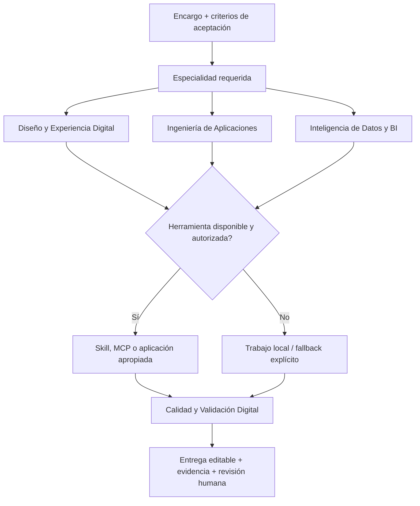

# Agencia de especialistas — taxonomía por capacidad

Los agentes de [Agency Agents](../../README.md) están ordenados por **qué saben hacer**, no por su proveedor. En este fork, los siete especialistas incorporados se agrupan en cuatro divisiones funcionales visibles en la aplicación. Las divisiones generales del catálogo original permanecen; esta es una **capa especializada complementaria**, no una sustitución masiva de cientos de agentes originales.

**Tres dimensiones independientes:**

- **Especialidad:** diseño y experiencia digital, ingeniería de aplicaciones, inteligencia de datos/BI y calidad/validación.
- **Capacidades opcionales:** PyModel, Superdesign, Onlook, Streamlit, Superset y Metabase. Son tools, skills, MCP o aplicaciones, **no seis agentes extra**.
- **Procedencia:** AgentLand, VoltAgent, adaptación comunitaria, o IA-Gov original. Se documenta en el perfil y no determina la división funcional.

### Diseño y Experiencia Digital

| Agente real | Perfil del catálogo | Procedencia |
| --- | --- | --- |
| **VoltAgent UI Designer** | [digital-experience/digital-experience-voltagent-ui-designer.md](../../digital-experience/digital-experience-voltagent-ui-designer.md) | [VoltAgent / referencia original](https://github.com/VoltAgent/awesome-claude-code-subagents/blob/main/categories/01-core-development/ui-designer.md) |
| **VoltAgent UX Researcher** | [digital-experience/digital-experience-voltagent-ux-researcher.md](../../digital-experience/digital-experience-voltagent-ux-researcher.md) | [VoltAgent / referencia original](https://github.com/VoltAgent/awesome-claude-code-subagents/blob/main/categories/08-business-product/ux-researcher.md) |
| **VoltAgent Design Bridge** | [digital-experience/digital-experience-voltagent-design-bridge.md](../../digital-experience/digital-experience-voltagent-design-bridge.md) | [VoltAgent / referencia original](https://github.com/VoltAgent/awesome-claude-code-subagents/blob/main/categories/01-core-development/design-bridge.md) |

### Ingeniería de Aplicaciones

| Agente real | Perfil del catálogo | Procedencia |
| --- | --- | --- |
| **VoltAgent Fullstack Developer** | [application-development/application-development-voltagent-fullstack-developer.md](../../application-development/application-development-voltagent-fullstack-developer.md) | [VoltAgent / referencia original](https://github.com/VoltAgent/awesome-claude-code-subagents/blob/main/categories/01-core-development/fullstack-developer.md) |

### Inteligencia de Datos y BI

| Agente real | Perfil del catálogo | Procedencia |
| --- | --- | --- |
| **VoltAgent Data Analyst** | [data-intelligence/data-intelligence-voltagent-data-analyst.md](../../data-intelligence/data-intelligence-voltagent-data-analyst.md) | [VoltAgent / referencia original](https://github.com/VoltAgent/awesome-claude-code-subagents/blob/main/categories/05-data-ai/data-analyst.md) |
| **Dashboard Engineer** | [data-intelligence/data-intelligence-dashboard-engineer.md](../../data-intelligence/data-intelligence-dashboard-engineer.md) | [VoltAgent / referencia original](https://github.com/VoltAgent/awesome-claude-code-subagents/blob/main/categories/05-data-ai/data-analyst.md) (adaptación comunitaria, no agente oficial) |

### Calidad y Validación Digital

| Agente real | Perfil del catálogo | Procedencia |
| --- | --- | --- |
| **VoltAgent Accessibility Tester** | [digital-quality/digital-quality-voltagent-accessibility-tester.md](../../digital-quality/digital-quality-voltagent-accessibility-tester.md) | [VoltAgent / referencia original](https://github.com/VoltAgent/awesome-claude-code-subagents/blob/main/categories/04-quality-security/accessibility-tester.md) |

## Capacidades externas (sin perfiles artificiales)

| Especialista que realiza el trabajo | Herramientas seleccionables, sólo si están realmente disponibles |
| --- | --- |
| UI Designer (original y VoltAgent) | [PyModel designer-skill](https://github.com/PyModel/designer-skill) para preflight y revisión estática, [Superdesign](https://github.com/superdesigndev/superdesign-skill) para explorar visuales con cuenta/créditos autorizados |
| Frontend Developer / Fullstack Developer | [Onlook](https://github.com/onlook-dev/onlook) si existe un editor accesible y el proyecto Next.js/Tailwind corresponde; fallback desarrollo local |
| Dashboard Engineer | [Streamlit](https://github.com/streamlit/streamlit) para apps Python ligeras; [Metabase](https://github.com/metabase/metabase) para BI de consultas sencillo; [Superset](https://github.com/apache/superset) para BI avanzado y su infraestructura |
| Accessibility Auditor | PyModel opcional como **evidencia estática adicional**, no sustituto de pruebas reales con tecnologías asistivas |

La [guía técnica Windows/Codex](tool-integrations/README.md) y [el registro de capacidades JSON](tool-integrations/registry.json) mantienen requisitos, licencias, instalación, límites gratuitos, fallbacks, riesgos y rutas de enrutamiento. Ningún programa queda instalado por añadir este catálogo.

## Arquitectura de cooperación



No se inventan resultados de aplicaciones que no se han ejecutado. Los análisis y prototipos conservan su profundidad y las capacidades de edición existentes.

## Cómo verlo en Agency Agents

1. Actualizar el clon local de `rubeabbo/agency-agents-ia-gov` con `git pull` (o sincronizar GitHub Desktop).
2. Dentro de Agency Agents, ir a **Configuración → Catálogo → Usa tu propio clon → Elija carpeta…** y seleccionar esa copia local.
3. Actualizar catálogo y buscar **Diseño y Experiencia Digital**, **Ingeniería de Aplicaciones**, **Inteligencia de Datos y BI** o **Calidad y Validación Digital**. Los siete perfiles nuevos aparecen en esas divisiones.
4. Si habías instalado alguno de los seis antiguos `Community ... Tool Operator`, **desinstalarlo de Codex** desde Agency Agents: eliminarlo del repositorio no borra automáticamente una instalación local gestionada o ajena. También puede persistir el slug anterior `community-dashboard-engineer` después del cambio de nombre a `dashboard-engineer`.

Para Codex (Git Bash desde el fork actualizado, después de aprobar la reorganización):

```bash
bash scripts/check-divisions.sh
bash scripts/convert.sh --tool codex
bash scripts/install.sh --tool codex --list agents
bash scripts/install.sh --tool codex --agent dashboard-engineer,voltagent-ui-designer,voltagent-data-analyst --dry-run
# Quitar --dry-run sólo después de revisar resultados e instalaciones anteriores.
```

## Autoría y licencias

- Las adaptaciones de VoltAgent conservan sus URL de origen y la [licencia MIT íntegra, © 2025 VoltAgent](LICENSE-VoltAgent.md).
- **Dashboard Engineer** es una adaptación comunitaria inspirada por VoltAgent; no es un agente oficial del proveedor ni autoría original de IA-Gov.
- `ia-gov/` permanece reservado a Arquitecto, Cerbero, Graffitero y otros agentes propios; no se modificaron sus perfiles ni se atribuyeron externos a IA-Gov.
- `divisions.json` registra las cuatro áreas como divisiones operativas; las variantes del catálogo original siguen en sus carpetas base.
