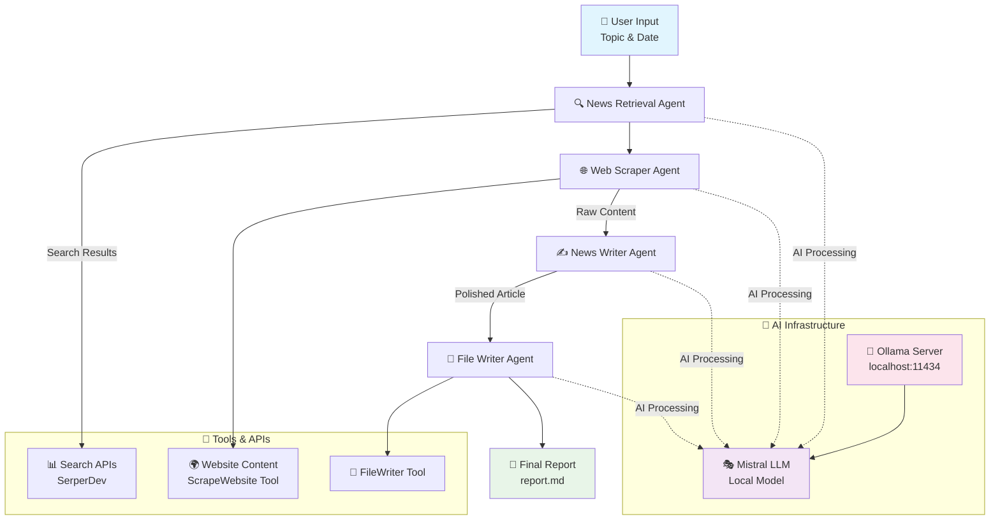

# AI Latest Political News Crew

A CrewAI-powered autonomous news gathering and reporting system that leverages multiple AI agents to research, scrape, and generate comprehensive political news reports using local LLM (Mistral).

## Features

- **Multi-Agent System**: Four specialized AI agents working collaboratively
- **Local LLM Integration**: Uses Ollama with Mistral model for privacy and control
- **Automated News Pipeline**: From research to final report generation
- **Real-time Updates**: Fetches latest political news based on current date
- **Markdown Output**: Clean, structured reports ready for publishing

##  System Architecture



## 🚀 Quick Start

### Prerequisites
- Ollama installed and running
- SerperDev API key (for web searching)

### Installation

1. Clone the repository
2. Install dependencies
3. Setup Ollama with Mistral
4. Configure API Keys
  

The system will automatically:
1. Search for latest Indian political news
2. Scrape relevant websites
3. Generate a comprehensive report
4. Save it as `report.md`

## 🎭 The AI Crew

| Agent | Role | Responsibility |
|-------|------|----------------|
| 🔍 **News Retrieval Agent** | Political News Researcher | Searches and summarizes latest political developments |
| 🌐 **Website Scraper Agent** | Web Scraping Specialist | Extracts clean content from news websites |
| ✍️ **News Writer Agent** | Journalist | Transforms raw data into engaging news articles |
| 💾 **File Writer Agent** | Archivist | Saves formatted reports to files |

## ⚙️ Configuration

## Local LLM Setup
The system uses Mistral through Ollama:
```python
mistral_llm = LLM(
    model="ollama/mistral",
    base_url="http://localhost:11434"
)
```
